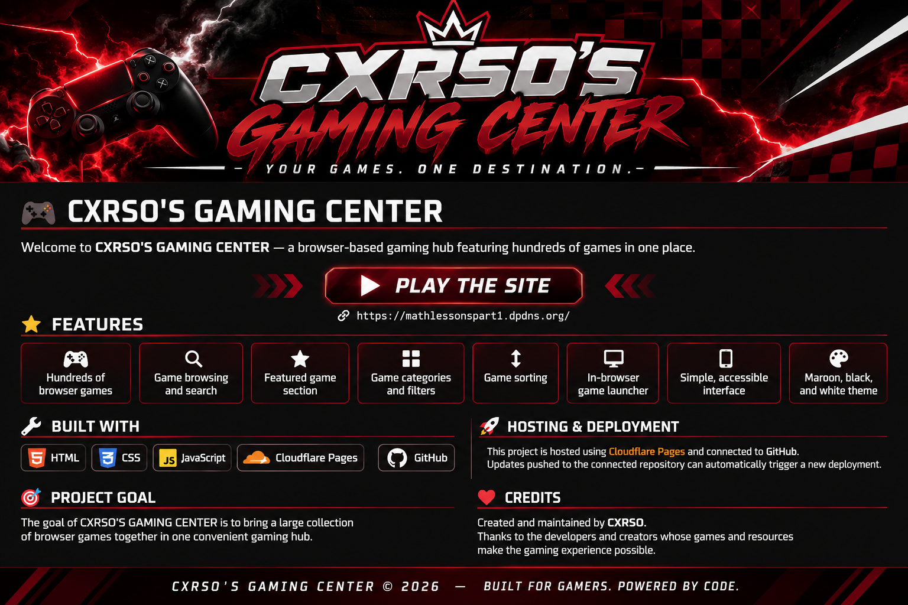

🎮 CXRSO'S GAMING CENTER

A browser-based gaming hub bringing hundreds of games together in one place.

🌐 Play Now

"Launch CXRSO'S GAMING CENTER" (https://mathlessonspart1.dpdns.org/)

✨ About the Project

CXRSO'S GAMING CENTER is a personal web project built to create a simple, accessible place to discover and play browser games.

🛠️ Technology

- HTML5
- JavaScript
- GitHub
- Cloudflare Web Hosting
- DigitalPlat Domain

🚀 Deployment

The website is hosted through Cloudflare Pages and connected to this GitHub repository for updates and deployments.

📌 Project Information

Detail| Information
Project| CXRSO'S GAMING CENTER
Creator| CXRSO
Type| Browser Gaming Hub
Status| Active Development
Year| 2026

❤️ Credits

Built and maintained by CXRSO.

Game content and resources are provided by their respective creators and sources.

---

  **CXRSO'S GAMING CENTER © 2026**
   
  *Built for gamers. Powered by code.*

--->>SITE IS SUBJECT TO CHANGE DOMAINS AT ANY TIME<<---

        DONY ASK ME IF ITS BLOCKED FOR YOU
            I CANT POSSIBLY KNOW THAT
